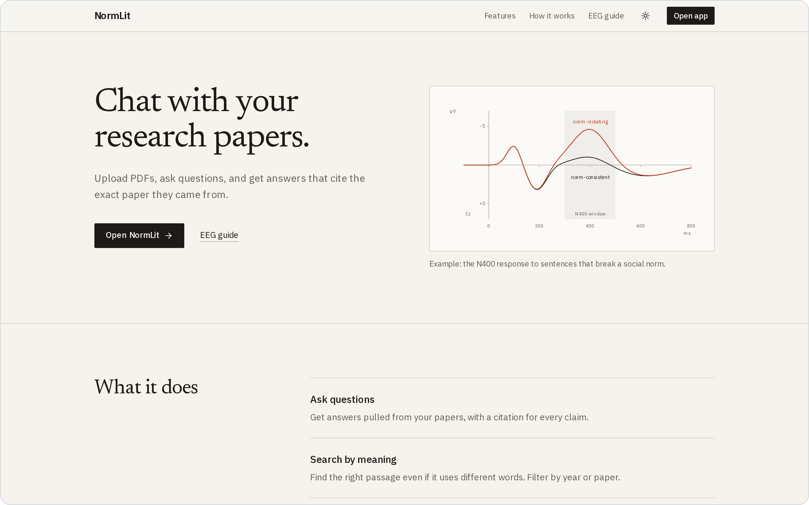
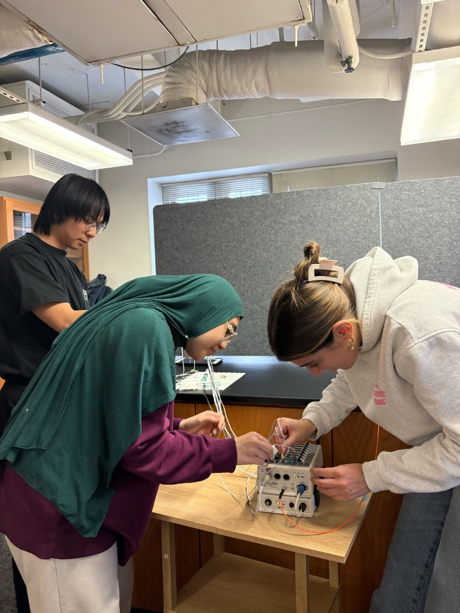
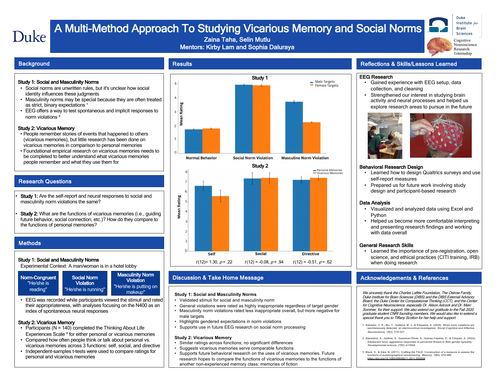
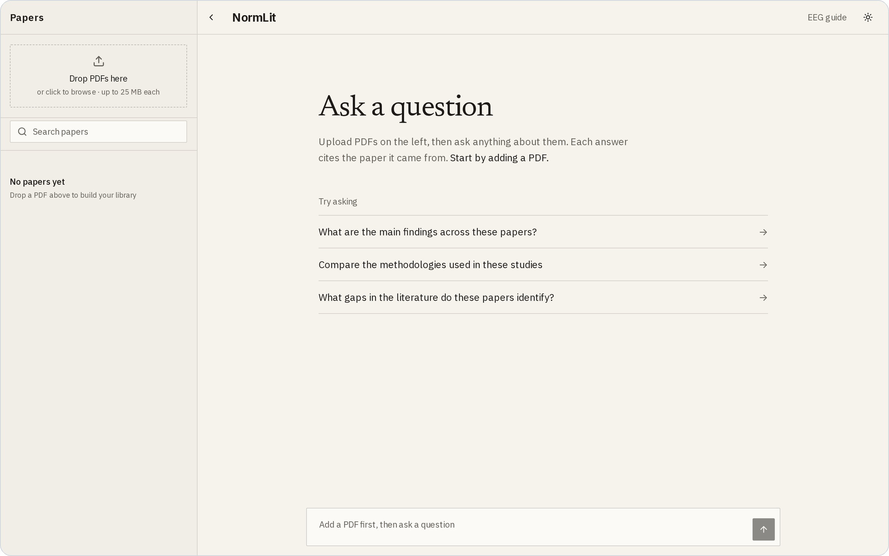
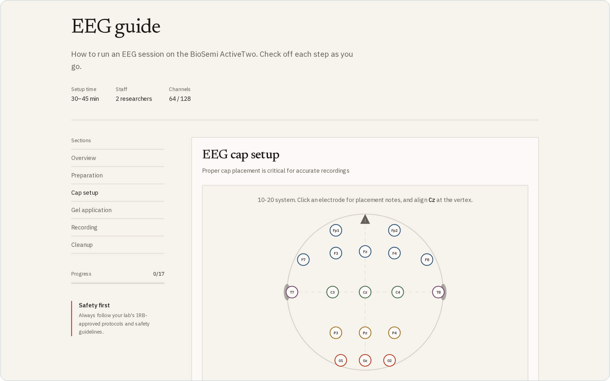
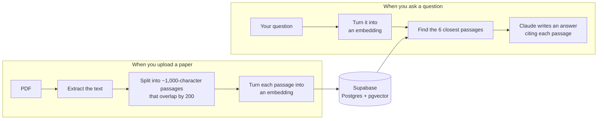
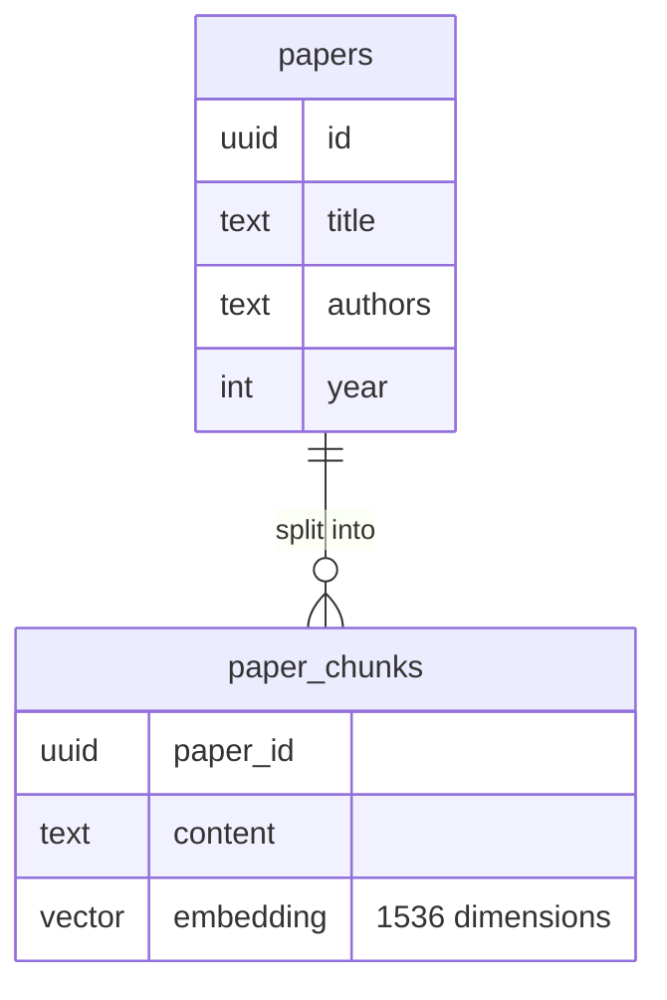

# NormLit

NormLit lets a research lab chat with its own library of papers. You upload PDFs, ask questions in plain English, and every answer cites the exact paper it came from. It's live at [normlit on Vercel](https://v0-normlit-research-assistant-djiy.vercel.app/).



## Where it started

I built NormLit during Duke's Cognitive Neuroscience Research Internship (CNRI), where I ran EEG research on how the brain responds when a sentence breaks a social norm, using the N400 brain response. A lot of my team's time went to things that weren't the science itself, like cross-referencing dozens of papers by hand to find the one paragraph that answered a question, and working through a 100-page instruction packet just to run a single EEG session. I wanted to build something that gave that time back.





## What you can do with it

You drop PDFs into the sidebar and NormLit splits them into passages and indexes them. When you ask a question, it finds the passages that match what you mean, even if they use different words, and writes an answer where every claim is tagged with the paper and year it came from, so you can always go back and check. You can narrow a question to specific papers, or pick two or more and ask NormLit to compare their methods and results side by side.



NormLit also comes with an EEG guide that turns that 100-page packet into a step-by-step protocol for the BioSemi ActiveTwo, covering preparation, cap setup, gel application, recording, and cleanup. Each section has a checklist that tracks your progress across 17 steps, and the cap setup section has a clickable 10-20 electrode map that shows placement notes for each electrode. It lives at [/eeg-guide](https://v0-normlit-research-assistant-djiy.vercel.app/eeg-guide).



## How it works

NormLit uses retrieval-augmented generation (RAG), which means the model only answers from passages pulled out of your own papers, not from whatever it remembers.



Passages are split at sentence boundaries where possible, so a citation never points at half a sentence, and the 200-character overlap keeps an idea that spans two passages from getting lost between them. Search keeps only passages that are at least 50% similar to your question. Comparing papers works the same way, except it pulls 12 passages from just the papers you picked and lowers the bar to 30%, since a good comparison needs more context from each one.

### Why I picked each piece

| Layer | What I used | Why | What it costs me |
|-------|-------------|-----|------------------|
| App | Next.js 16 and React with Tailwind and shadcn/ui | Pages and API routes live in one project, and the components are accessible out of the box | A lot of framework for what's mostly two pages |
| AI calls | Vercel AI SDK 6 | Streams answers word by word, and switching between Claude and GPT-4o is a one-line change | Another layer between my code and the model APIs |
| Answers | Claude Opus 4.8, with GPT-4o as a fallback | Strong at long, careful answers that stick to the sources it's given | Slower and more expensive per question than a smaller model |
| Embeddings | OpenAI text-embedding-3-small | Cheap and accurate enough for academic text | Every paper depends on this one model, and switching means re-embedding the whole library |
| Database | Supabase with pgvector | Papers, passages, and vector search all live in one Postgres database | Similarity search happens in SQL, which is harder to tune than a dedicated vector database |
| Hosting | Vercel | Deploys on every push, with preview links for every branch | Serverless time limits cap how big a PDF can be processed in one request |

### The data model



## What I'd change next

There are no accounts yet, so everyone who opens the app shares one paper library, which works for a single lab but not beyond that. Passages are split by character count, so tables and figure captions sometimes get cut in awkward places, and the next step is splitting by section instead. I'd also like to build a small set of questions with known answers from the lab's papers, so I can measure whether a change to the chunking or the similarity cutoff actually makes answers better.

## Running it locally

```bash
git clone https://github.com/selinmutlu06/NormLit.git
cd NormLit
pnpm install
```

Create `.env.local` with your keys:

```
NEXT_PUBLIC_SUPABASE_URL=your_supabase_url
NEXT_PUBLIC_SUPABASE_ANON_KEY=your_supabase_anon_key
SUPABASE_SERVICE_ROLE_KEY=your_supabase_service_role_key
OPENAI_API_KEY=your_openai_api_key
ANTHROPIC_API_KEY=your_anthropic_api_key
```

Then run `pnpm dev`, open http://localhost:3000/chat, and drop PDFs into the sidebar. To load a whole folder at once, run `npx tsx scripts/ingest-papers.ts ./path/to/papers`, with files named like `Author (Year) - Title.pdf`.

## Project structure

```
app/
  page.tsx              landing page
  chat/page.tsx         chat with your papers
  eeg-guide/page.tsx    BioSemi EEG protocol
  api/
    chat/route.ts       retrieval and answers
    compare/route.ts    comparing papers
    upload/route.ts     PDF upload and indexing
    papers/route.ts     paper library
    health/route.ts     checks which services are configured
components/
  chat-message.tsx      renders answers and citations
  paper-sidebar.tsx     upload and filters
  compare-panel.tsx     paper comparison
  electrode-map.tsx     clickable 10-20 map
lib/
  ingest.ts             text extraction, chunking, embeddings
  ai.ts                 picks the chat model
scripts/                database schema and bulk ingestion
```

## License

MIT

<sub>Built at Duke CNRI, for researchers who'd rather spend their time on the science.</sub>
